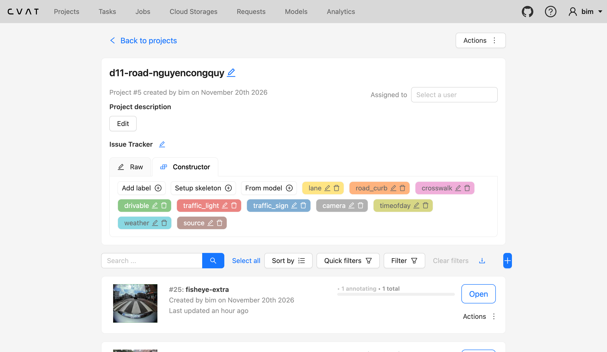
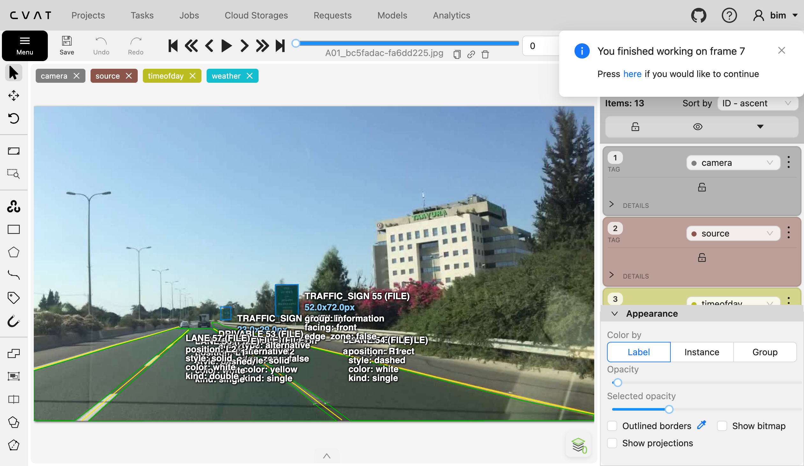
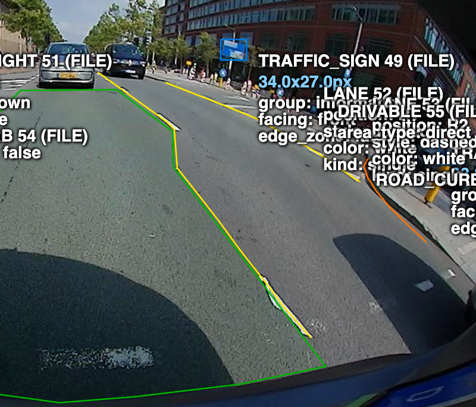
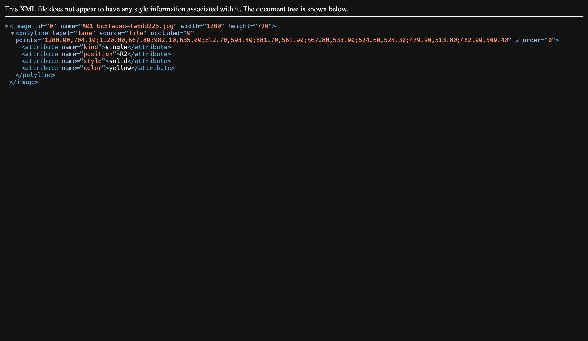

# Báo cáo cá nhân — Ngày 11 · Road Elements & SVM

**Học viên:** Nguyễn Công Quý · **Mã học viên:** 2A202603149

**Hình thức:** Bài cá nhân.

**Guideline:** Road v1.0 · **Lần nộp:** 1

**Phiên bản CVAT:** 2.74.1 (server và UI, xem tại About). Định dạng export CVAT for images 1.1.

**Thời điểm export bản sửa:** 20/11/2026, khoảng 21:48 (UTC+7).

**Số lần nộp lại sau Rework:** Chưa có thông tin.

## 1. Kiểm project

Project `d11-road-nguyencongquy`. Bốn job front #22, fisheye #23, front-extra #24 và fisheye-extra #25 hiển thị `completed` trên CVAT.

| Mục | Kết quả |
| --- | --- |
| 6 label vẽ | `lane`, `road_curb` là polyline, `drivable`, `crosswalk` là polygon, `traffic_light`, `traffic_sign` là rectangle. |
| Thuộc tính | Dùng cấu hình Road v1.0 của repo. Kết quả lint còn 5 cảnh báo thiếu vạch, có giải trình ở mục 5.1. |
| 4 tag ảnh | Đủ `camera`, `timeofday`, `weather`, `source` trên 28 ảnh. |

Kết thúc polyline bằng phím **N**. Đặt tag bằng công cụ **Tag** rồi mở **Details** để kiểm tra thuộc tính `value`.

## 2. Số lượng đã gán

Đếm từ `annotations.xml` trong hai ZIP cuối.

| Task | Ảnh | lane | road_curb | crosswalk | drivable | traffic_light | traffic_sign |
| --- | ---: | ---: | ---: | ---: | ---: | ---: | ---: |
| front | 12 | 27 | 13 | 4 | 22 | 30 | 27 |
| front-extra | 4 | 12 | 1 | 2 | 8 | 12 | 12 |
| fisheye | 8 | 7 | 14 | 8 | 5 | 8 | 8 |
| fisheye-extra | 4 | 0 | 5 | 4 | 1 | 2 | 0 |
| **Tổng** | **28** | **46** | **33** | **18** | **36** | **52** | **47** |

## 3. Ca khó

| Ảnh | Nhãn | Phân vân | Cách xử lý và lý do |
| --- | --- | --- | --- |
| A05, A06, A07, A12 | `lane` | Thiếu L1 hoặc R1 | Giữ nhãn theo vạch sơn quan sát được. Mục 5.1 ghi cụ thể từng phía và lý do. |
| A08 | `lane` | Hai polyline cùng L1 | Gộp hai đoạn thẳng hàng thành một polyline L1 màu trắng liền. |
| B05 | `lane` | Vị trí vạch trên fisheye trái | Đổi `position=other` theo quy tắc camera hai bên. |

## 4. Phiếu QC 1 nhận được

**Người kiểm lô:** Phùng Danh Khoa (MSHV 2A202603206).

**Kết luận của Phùng Danh Khoa:** Release. Các mục đã kiểm trên lô nhãn của Nguyễn Công Quý đạt yêu cầu, không có lỗi cần sửa theo phản hồi kiểm chéo.

## 5. Kiểm file export

| File | Mở lại bằng lint | Số shape ảnh đầu (job / XML) | Số shape ảnh thứ hai (job / XML) | Tag camera trong XML |
| --- | --- | ---: | ---: | --- |
| `nguyencongquy-front.zip` | Có · 16 ảnh | A01 · 9 / 9 | A02 · 7 / 7 | Có · `front` ở A01 và A02 |
| `nguyencongquy-fisheye.zip` | Có · 12 ảnh | B01 · 6 / 6 | B02 · 9 / 9 | Có · `fisheye_front` ở B01 và B02 |

Đã đối chiếu mục Objects trên CVAT với XML cho cả bốn ảnh. Số shape không gồm tag. Mỗi ảnh kiểm có đủ bốn tag. Hai ZIP chỉ chứa `annotations.xml`. Manifest ghi `contains_images=false`; lint còn 5 cảnh báo `QC1-02`.

### 5.1. Giải trình 5 cảnh báo QC1-02

Bảng dưới đây ghi lý do giữ nguyên nhãn ở từng vị trí mà lint báo thiếu L1/R1. Kết quả trong manifest là **5 cảnh báo nặng, 0 lỗi chính, 0 lỗi nhẹ**.

| Ảnh | Vạch bị báo thiếu | Quan sát trên ảnh gốc |
| --- | --- | --- |
| `A05_b2576c8c-2de20b8a.jpg` | L1 · trái | Mặt đường phía trái làn xe chụp không thấy vạch sơn phân làn. Dãy xe đỗ bên trái che một phần mép đường. |
| `A05_b2576c8c-2de20b8a.jpg` | R1 · phải | Phía phải có xe đỗ và mép vỉa hè. Không thấy vạch sơn dọc làm ranh phải của làn xe chụp. |
| `A06_b8c66e31-37045eec.jpg` | R1 · phải | Có vạch qua đường và nét sơn trắng sát lề phải. Chưa xác định được nét nào là ranh phải của làn xe chụp qua nút giao. |
| `A07_b41ace08-c8468690.jpg` | L1 · trái | Ranh bên trái là dải chắn bê tông. Không thấy vạch sơn riêng dọc chân dải chắn trong phần đường quan sát được. |
| `A12_c0f978fa-9b4e623f.jpg` | R1 · phải | Phía phải sau vạch qua đường có lề và xe đỗ. Chưa thấy vạch sơn dọc xác định ranh phải của làn xe chụp. |

Tình trạng xét ngoại lệ theo [quy định nộp bài](SUBMISSION.md): chưa có xác nhận.

## 6. Ảnh chụp màn hình

1. **Nhãn project** · 6 label vẽ và 4 tag trong phần Constructor của project.

   

2. **Front A01** · vạch làn, vùng lái và biển chỉ dẫn.

   

3. **Fisheye B03** · ảnh chụp cắt cận đoạn polyline cạnh vùng lái.

   

4. **XML A01** · đoạn polyline lane trích từ `annotations.xml` trong ZIP front.

   

## 7. Tự đánh giá

`QC1-02` là cảnh báo lặp nhiều nhất trong lần lint cuối. Khi rà bài Ngày 20, cần tìm vạch sơn gần xe ở hai bên trước, sau đó theo vạch đến điểm xa nhất còn thấy. Ghi lại từng vị trí không xác định được vạch sơn cùng dấu hiệu quan sát trên ảnh gốc.

Nếu hai đoạn của cùng một vạch L1 bị gán thành hai polyline tách rời như ở A08, các hàng neo giữa hai đoạn có thể bị tạo nhầm thành hàng không có làn. Gộp lại giúp dữ liệu phản ánh một vạch liên tục dọc theo các hàng quan sát được.
